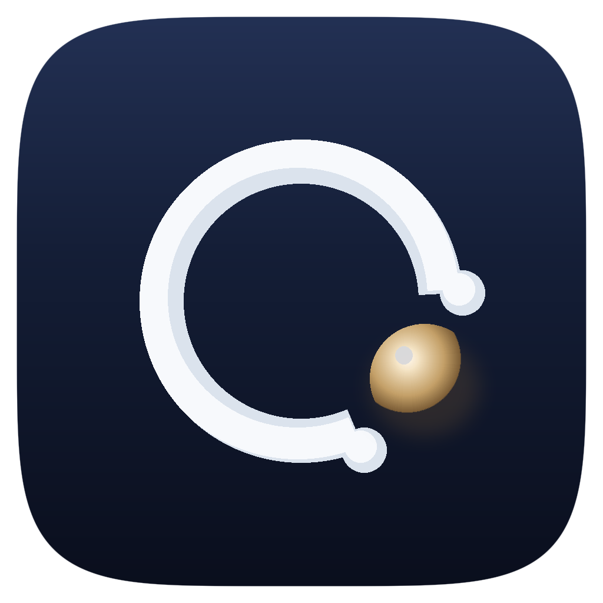

<p align="center"></p>

<h1 align="center">所得</h1>

<p align="center"><b>所想即所得。</b><br>
用你自己的话，搜索这台电脑里文件的内容：照片、截图、PDF、文档、录音、视频和代码。<br>
模型是 Google DeepMind 的 <a href="https://huggingface.co/google/embeddinggemma-2">EmbeddingGemma 2</a>，索引和搜索都在本机完成。</p>

<p align="center">
代码名 Suode · 包名 <code>suode</code> · 标识 <code>com.xiaoou.suode</code><br>
维护者 <a href="https://github.com/xiaoou-waou">xiaoou</a>
</p>

所得（Suode）是 [DigUp](https://github.com/ARahim3/DigUp) 的再品牌。DigUp 由 [Abdur Rahim](https://github.com/ARahim3) 以 MIT 许可证发布。本仓库保留该许可证和版权声明，并明确注明源自 DigUp。所得不隶属 Google、Apple 或 Microsoft。

## English

Suode (所得, “what you imagine is what you get”) searches the files on your computer by what is in them — pictures, PDFs, documents, recordings, videos, and code — with EmbeddingGemma 2, on device. It is a rebrand of [DigUp](https://github.com/ARahim3/DigUp) by Abdur Rahim (MIT). Bundle id: `com.xiaoou.suode`. Maintainer: [xiaoou-waou](https://github.com/xiaoou-waou).

Automatic updates are off. The Sparkle appcast and the Windows/Linux update feeds in this repo are empty placeholders, and they do not carry DigUp’s signing keys, so this app cannot install DigUp over itself. There is no Homebrew tap and no DigUp sponsorship link.

## 能找到什么

- 「视频里的斑马」会打开出现斑马的那一帧
- 「他们讲到睡眠的地方」会跳到播客的那一分钟
- 「租约里关于宠物的条款」会打开 PDF 的那一页
- 「沙滩上的狗」能找到照片；「支付被拒」能找到截图
- 用一种语言搜索，可以找到模型所支持的一百多种语言写成的笔记
- 打开代码搜索后，「code: 失败后按退避重试」能找到对应函数

文件名和正文里的原词也会匹配，所以发票号、错误码和人名不会只靠语义。在 Mac 上，截图里的文字同样参与匹配。

## 隐私

你索引的内容不会离开这台电脑。所得只会在第一次下载模型时联网。更新检查默认关闭；就算打开，也只访问本仓库里的空占位源，不会把 DigUp 装回来盖掉自己。没有账号，没有遥测。

## 从源码构建

本仓库不提供会自我覆盖的安装包。Mac 需要 Xcode 26、git，以及用来编译 llama.cpp 的 CMake（或 `uv`）。如果 `xcode-select -p` 指向命令行工具，先改到完整 Xcode。

```sh
git clone https://github.com/xiaoou-waou/suosijisuode && cd suosijisuode
python3 scripts/make-icon.py   # 图标：午夜底、冷白弧、暖象牙珍珠
scripts/build-llama.sh         # 固定版本的 llama.cpp，带一行补丁
swift build -c release && swift test
./build.sh                     # → build.noindex/所得.app
```

命令行工具是 `.build/release/suode`（`suode --help`）。Mac 应用的可执行文件在 `所得.app` 里，引擎模块是 SuodeKit，界面是 SuodeApp。

Windows 和 Linux 需要 Swift 6.4、Rust 和 Node。Windows 还需要 Visual Studio 的 C++ 构建工具，并在 Git Bash 里运行。`scripts/fetch-vendor.sh` 和 `scripts/build-llama.sh` 取依赖，`scripts/package-linux.sh` 打出名为 `suode` 的 .deb 和 AppImage，`scripts/package-windows.sh` 打出安装包，主程序是 `所得.exe`，旁边的 helper 是 `suode.exe`。步骤见 [packages 工作流](.github/workflows/packages.yml)。

图标由 `scripts/make-icon.py` 生成：Mac 的 `AppIcon`、菜单栏 `tray*.png`、`docs/logo.png`、`shell/ui/icon.png` 和 `shell/src-tauri/icons`。索引时金属弧变暗，颜色从顶部顺时针扫回；暂停时珍珠换成两道竖条；有更新时程序在右上角加一个点。

## 数据目录

| 系统 | 模型与索引 | 设置 |
|---|---|---|
| macOS | `~/Library/Application Support/Suode` | `~/Library/Preferences/com.xiaoou.suode.plist` |
| Windows | `%LOCALAPPDATA%\Suode` | `%APPDATA%\com.xiaoou.suode` |
| Linux | `~/.local/share/suode`（或 `$XDG_DATA_HOME/suode`） | `~/.config/com.xiaoou.suode` |

环境变量使用 `SUODE_` 前缀，例如 `SUODE_MODELS`、`SUODE_DEVICE`、`SUODE_WORKER_DIR`。参考 worker 的包名是 `suode-worker`。

## 它会读什么

只读你选中的文件夹：图片、PDF（含扫描件）、txt / md / rtf / docx / odt / html（Mac 上还有 doc）、任意长度的音频和视频。代码搜索默认关闭。它不读密钥、证书、密码文件、`.ssh` 这类隐藏目录、应用和缓存，也不下载只存在于云端的文件（Mac 的 iCloud、Windows 的 OneDrive）。它只读，不改、不移动、不上传。

Mac 上用系统框架（ImageIO、PDFKit、AVFoundation，截图文字用 Vision），界面是 SwiftUI。Windows 和 Linux 上用 PDFium、ffmpeg、stb 和 miniz，界面是 [Tauri](https://tauri.app)。嵌入运行在 llama.cpp 上：Mac 用 Metal；Windows 和 Linux 在测得显卡更快且结果一致时用 Vulkan，否则用处理器。

## 更新

自动更新默认关闭。

- Mac：`SUEnableAutomaticChecks` 为 false，`SUFeedURL` 指向本仓库的 [`appcast.xml`](appcast.xml)。这份源是空的，Info.plist 里也没有 DigUp 的 Sparkle 公钥。
- Windows / Linux：更新地址指向 [`updates/`](updates/) 里的占位 JSON，版本是 `0.0.0`，没有安装包，也没有 DigUp 的签名。配置里的 minisign 公钥是所得自己的，对不上 DigUp 的包。

因此即使用户后来打开「检查更新」，也不能把 DigUp 装到所得上面。

## 致谢

所得建立在 Google DeepMind 的 [EmbeddingGemma 2](https://huggingface.co/google/embeddinggemma-2)（Apache 2.0）和 [llama.cpp](https://github.com/ggml-org/llama.cpp)（MIT）之上。Mac 版仍链接 [Sparkle](https://sparkle-project.org)（MIT）但默认不检查更新。Windows 和 Linux 版使用 Tauri，并用 PDFium、FFmpeg（LGPL）、stb 和 miniz 读文件。这些声明随应用附上，见 `Resources/Acknowledgements.txt`。

Gemma 是 Google LLC 的商标。Mac 与 Spotlight 是 Apple Inc. 的商标。Windows 是 Microsoft Corporation 的商标。

## 许可证

MIT。Copyright (c) 2026 Abdur Rahim。全文见 [LICENSE](LICENSE)。
